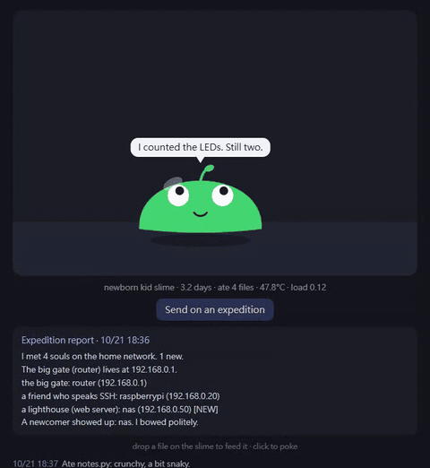

# slime-pi

A slime that lives in your Raspberry Pi. Feed it files, say hi over SSH, and read its daily expedition report of your home network.

**English** | [繁體中文](README.zh-TW.md)



It is not a monitor with a face. It is a small creature whose life is tied to the Pi it lives in:

- **It feels the Pi.** Hot CPU: it sweats. Heavy load: it pants. No internet: it spins in circles. Late at night and idle: it sleeps.
- **It remembers you.** It greets you when you log in over SSH. Stay away for 3 days and it sulks.
- **You feed it.** Drag any file onto the page. It eats it (the file is **not** stored, only name, size and extension) and its personality changes: lots of `.py` makes a *snakey* slime, lots of images a *dreamy* one.
- **It explores.** On your first login each day it quietly walks your home network and writes an **expedition report**: who it met, who is new, who went missing.
- **It grows.** Baby, kid, adult, elder, with a sprout, an antenna and finally a crown.
- **It speaks your language.** It reads the Pi's system language when you log in. English and 繁體中文 are built in, and [adding another takes one JSON file](CONTRIBUTING.md#add-a-language).
- **It is cheap to run.** Wakes every 30 seconds, reads a few files, limited to 10% of one CPU core and 64 MB by systemd.
- **It steps aside.** Every wake-up it checks memory, CPU load and temperature. When things get tight it stops optional work (no expeditions). If the Pi stays critically short for about 90 seconds (under 5% memory free, load above twice the cores, or 80 °C), it tells you first (speech bubble on the page, a `wall` message to open terminals, a diary entry), waits 30 seconds, then shuts itself down so your other programs get the room. It does not restart by itself; wake it with `systemctl --user start slime`. Run `slime` to see why it slept.

## Install

On the Pi (Raspberry Pi OS, Python 3.11+, nothing to `pip install`):

```bash
git clone https://github.com/MilkteaTW1/slime-pi.git
cd slime-pi
./install.sh
```

Then open `http://<your-pi>.local:8077` in a browser on the same network, or run `slime` in a terminal.

To remove it: `./uninstall.sh`.

Tested on a Raspberry Pi 3 Model B with Raspberry Pi OS Bookworm (64-bit). It should work on anything with systemd and Python 3, and test reports from other models are very welcome.

## What it does with your network

The expedition is a gentle ping walk of **your own /24 subnet only** (for example 192.168.0.1 to 254), run at the lowest CPU priority with 8 parallel pings, and it only runs on the first login of the day or when you press the button. It checks five common ports on hosts that answer, to decide whether something is a router, an SSH machine, a web server or a file share. Nothing leaves your Pi: the results (IP, MAC address, hostname) stay in `~/.slime/state.json` on the Pi.

## Files and privacy

- Dropped files are read from the network and discarded. Only the file name, size and extension are kept.
- The web page has no accounts and no login. Do not expose port 8077 to the internet.
- Everything the slime remembers is in `~/.slime/`. Delete that folder and it is reborn.

## How the mood works

| Pi state | Slime |
|---|---|
| No internet | dazed, eyes spinning |
| 65 °C or hotter | hot, red, sweating |
| Load 1.5+ or memory almost full | panting |
| 23:00 to 07:00 and idle | sleeping |
| No login for 3+ days | sulking |
| Under 50 °C and idle | happy |
| Anything else | chilling |

## Contributing

Translations are the easiest way in: copy `locales/en.json`, translate it, run `python tools/check-lang.py`, open a PR. New idle thoughts, new file-type tastes and test reports from other Pi models help too. See [CONTRIBUTING.md](CONTRIBUTING.md).

## License

[MIT](LICENSE)
