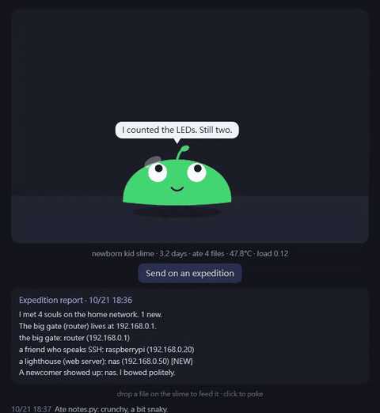

# slime-pi

[](https://github.com/MilkteaTW1/slime-pi/actions/workflows/ci.yml)


[](LICENSE)

**A virtual pet whose mood is your Raspberry Pi's real temperature, load and network, in one Python file with no dependencies.**

**English** | [繁體中文](README.zh-TW.md)

Website: [inkacuity.com/projects/slime-pi](https://inkacuity.com/projects/slime-pi) · 專案介紹頁



<!-- Photo slot: a real Pi on a desk with a phone or laptop showing the slime page.
     Save it as docs/photo.jpg and uncomment the next line.
 -->

It is not a monitor with a face. It is a small creature whose life is tied to the Pi it lives in:

- **It feels the Pi.** Hot CPU: it sweats. Heavy load: it pants. No internet: it spins in circles. Late at night and idle: it sleeps.
- **It remembers you.** It greets you when you log in over SSH. Stay away for 3 days and it sulks.
- **You feed it.** Drag any file onto the page. It eats it (the file is **not** stored, only name, size and extension) and its personality changes: lots of `.py` makes a *snakey* slime, lots of images a *dreamy* one.
- **It explores.** On your first login each day it quietly walks your home network and writes an **expedition report**: who it met, who is new, who went missing.
- **It grows.** Baby, kid, adult, elder, with a sprout, an antenna and finally a crown.
- **It speaks your language.** It reads the Pi's system language when you log in. English and 繁體中文 are built in, and [adding another takes one JSON file](CONTRIBUTING.md#add-a-language).
- **It is cheap to run.** Wakes every 30 seconds, reads a few files, limited to 10% of one CPU core and 64 MB by systemd.
- **It steps aside.** Every wake-up it checks memory, CPU load and temperature. When things get tight it stops optional work (no expeditions). If the Pi stays critically short for about 90 seconds (under 5% memory free, load above twice the cores, or 80 °C), it tells you first (speech bubble on the page, a `wall` message to open terminals, a diary entry), waits 30 seconds, then shuts itself down so your other programs get the room. It does not restart by itself; wake it with `systemctl --user start slime`. Run `slime` to see why it slept.

## What you need

| Part | Notes |
|---|---|
| Raspberry Pi | Tested on a Pi 3 Model B. Anything with systemd and Python 3.11+ should work ([report yours](https://github.com/MilkteaTW1/slime-pi/issues/4)). |
| microSD card, 8 GB or more | With Raspberry Pi OS (Bookworm tested). Lite is fine: the slime needs no desktop. |
| Power supply | The official one for your Pi model. An under-powered Pi runs hot, and the slime will tell you. |
| Network | Wi-Fi or Ethernet on your home LAN. The expedition only looks at the /24 the Pi is on. |
| A phone or computer with a browser | To see the slime and feed it files. |

**Wiring: none.** The slime reads everything from the system (`/sys/class/thermal`, `/proc/meminfo`, load average, `who`, `ip`). No GPIO, no sensors, no screen. A small screen or LED matrix is an [open idea](https://github.com/MilkteaTW1/slime-pi/issues/6) if you want to help.

## Install

On the Pi (Raspberry Pi OS, Python 3.11+, nothing to `pip install`):

```bash
git clone https://github.com/MilkteaTW1/slime-pi.git
cd slime-pi
./install.sh
```

`install.sh` sets up a **user** systemd service (no root needed) and a `slime` command in `~/.local/bin`. It also tries `loginctl enable-linger` so the slime keeps living after you log out; if that needs sudo it prints the command for you.

Then open `http://<your-pi>.local:8077` in a browser on the same network, or run `slime` in a terminal.

To remove it: `./uninstall.sh`. Its memories stay in `~/.slime/` until you delete that folder.

## How to play

| You do | The slime |
|---|---|
| Open `http://<your-pi>.local:8077` | Shows its mood, a speech bubble, its trait, stage, diary and the latest expedition report. The page refreshes every 4 seconds. |
| SSH into the Pi | Greets you. The first login of the day also sends it on an expedition. |
| Drag files onto the page | It eats them (up to 5 MB each; bigger ones it refuses). Each meal is worth 5 growth points and shapes its personality. |
| Click it | It squishes. Every 7th poke it says something. |
| Press the expedition button | Starts a walk of your LAN now (at most once every 10 minutes, and never when the Pi is short of resources). |
| Run `slime` in a terminal | Prints the slime, its mood, the last diary lines and the report. If it stepped aside, tells you when and why. |
| Leave it alone for 3 days | It sulks until you come back. |

**Growing up.** Growth points = hours alive + 5 per meal + 0.2 per poke. Kid at 20, adult at 100, elder at 400.

**Personality.** After 3 meals, the file type it ate most decides its trait: `.py` snakey, `.js` jittery, `.pdf` scholarly, `.jpg`/`.png` dreamy, `.mp3` musical, `.mp4` dramatic, `.zip` stocky, `.exe` spicy, `.xlsx`/`.docx` tidy. Otherwise the mood it spent most time in decides (a Pi that is always hot makes a hothead). The trait also sets its colour.

## What it does with your network

The expedition is a gentle ping walk of **your own /24 subnet only** (for example 192.168.0.1 to 254), run at the lowest CPU priority with 8 parallel pings, and it only runs on the first login of the day or when you press the button. It checks five common ports on hosts that answer, to decide whether something is a router, an SSH machine, a web server or a file share. If the Pi has a public address it does not walk at all. Nothing leaves your Pi: the results (IP, MAC address, hostname) stay in `~/.slime/state.json` on the Pi.

## Files and privacy

- Dropped files are read from the network and discarded. Only the file name, size and extension are kept.
- The web page has no accounts and no login. Do not expose port 8077 to the internet.
- Everything the slime remembers is in `~/.slime/`. Delete that folder and it is reborn.

## How the mood works

| Pi state | Slime |
|---|---|
| No internet | dazed, eyes spinning |
| 65 °C or hotter | hot, red, sweating |
| Load 1.5+ or memory almost full | panting |
| 23:00 to 07:00 and idle | sleeping |
| No login for 3+ days | sulking |
| Under 50 °C and idle | happy |
| Anything else | chilling |

Rows higher in the table win.

## Troubleshooting

- **Page does not load:** `systemctl --user status slime`. If it says the slime stepped aside, run `slime` to see why, then `systemctl --user start slime`.
- **`<pi>.local` does not resolve:** use the Pi's IP address instead (`hostname -I` on the Pi).
- **Wrong language:** it follows `/etc/default/locale` on login. Force one with `SLIME_LANG=zh_TW.UTF-8` in the service environment.
- **Different port:** set `SLIME_PORT`.

## Development

Runs on any computer; the Pi is mocked in the tests.

```bash
python -m unittest discover -s tests     # unit tests
python tools/check-lang.py               # locale check
```

## Contributing

Translations are the easiest way in: copy `locales/en.json`, translate it, run `python tools/check-lang.py`, open a PR. New idle thoughts, new file-type tastes and test reports from other Pi models help too. See [CONTRIBUTING.md](CONTRIBUTING.md).

## Need something custom?

Custom features, integrations or setup help are available. See [墨鋒 Inkacuity](https://inkacuity.com/projects/slime-pi) or email [ink@inkacuity.com](mailto:ink@inkacuity.com).

## License

[MIT](LICENSE)
