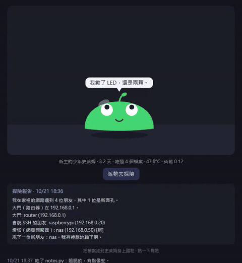

# slime-pi

住在你樹莓派裡的史萊姆。你可以餵牠檔案、用 SSH 跟牠打招呼，牠每天還會寫一份家裡網路的探險報告。

[English](README.md) | **繁體中文**



牠不是會笑的系統監控，而是一隻生活跟這台 Pi 綁在一起的小生物：

- **牠能感覺到 Pi。** CPU 太燙會流汗，負載高會喘氣，斷網會眼睛轉圈圈，深夜沒事就睡覺。
- **牠記得你。** 你用 SSH 登入時牠會打招呼，超過 3 天沒來就鬧彆扭。
- **你可以餵牠。** 把任何檔案拖到網頁上，牠就吃掉（檔案**不會**被保存，只記名字、大小和副檔名），個性也會改變：常吃 `.py` 會變「蛇味」，常吃圖片會變「愛作夢」。
- **牠會探險。** 每天第一次登入時，牠會悄悄走一圈你的家用網路，寫一份**探險報告**：遇到誰、誰是新面孔、誰不見了。
- **牠會長大。** 幼年、少年、成年、長老，依序長出芽、天線，最後戴上王冠。
- **牠說你的語言。** 你登入時會讀取 Pi 的系統語言。內建英文和繁體中文，要新增語言[只要一個 JSON 檔](CONTRIBUTING.md#add-a-language)。
- **很省資源。** 每 30 秒醒一次、讀幾個檔案，並被 systemd 限制在單核 10% 和 64 MB 以內。
- **會讓路。** 每次醒來都會檢查記憶體、CPU 負載和溫度。吃緊時會先停掉非必要的事（不去探險）。如果 Pi 連續約 90 秒嚴重不足（可用記憶體低於 5%、負載超過核心數的兩倍，或達 80 °C），牠會先通知你（網頁上的對話框、用 `wall` 廣播到開著的終端機、寫進日記），等 30 秒後自己關掉，把空間留給你的其他程式。牠不會自己重啟，想叫醒牠請輸入 `systemctl --user start slime`，輸入 `slime` 可以看到牠為什麼睡著。

## 安裝

在樹莓派上執行（Raspberry Pi OS、Python 3.9 以上，不需要 `pip install`）：

```bash
git clone https://github.com/MilkteaTW1/slime-pi.git
cd slime-pi
./install.sh
```

接著在同一個網路的瀏覽器開 `http://<你的樹莓派>.local:8077`，或在終端機輸入 `slime`。

要移除：`./uninstall.sh`。

已在 Raspberry Pi 3 Model B、Raspberry Pi OS Bookworm（64 位元）上測試。理論上任何有 systemd 和 Python 3 的環境都能跑，歡迎回報其他機型的測試結果。

## 牠會對你的網路做什麼

探險只會輕輕 ping 一遍**你自己所在的 /24 網段**（例如 192.168.0.1 到 254），以最低優先權執行、同時只有 8 個 ping，而且只在每天第一次登入或你按下按鈕時才跑。對有回應的裝置，牠會檢查 5 個常見連接埠，判斷是路由器、SSH 主機、網頁伺服器還是檔案分享。資料不會離開你的 Pi：結果（IP、MAC 位址、主機名稱）只存在 Pi 上的 `~/.slime/state.json`。

## 檔案與隱私

- 你拖進來的檔案會被讀取後丟棄，只保留檔名、大小和副檔名。
- 網頁沒有帳號也沒有登入，請不要把 8077 連接埠開放到網際網路。
- 牠記得的一切都在 `~/.slime/`，刪掉整個資料夾牠就會重新誕生。

## 心情怎麼決定

| Pi 的狀態 | 史萊姆 |
|---|---|
| 沒有網路 | 暈眩，眼睛轉圈 |
| 65 °C 以上 | 發燙、變紅、流汗 |
| 負載 1.5 以上或記憶體快滿 | 喘氣 |
| 23:00 到 07:00 且很閒 | 睡覺 |
| 3 天以上沒人登入 | 鬧彆扭 |
| 50 °C 以下且很閒 | 開心 |
| 其他 | 發呆 |

## 參與貢獻

最簡單的方式是翻譯：複製 `locales/en.json`、翻成你的語言、執行 `python tools/check-lang.py`，然後開 PR。新的碎碎念、新的檔案口味、其他機型的測試回報也都很有幫助。詳見 [CONTRIBUTING.md](CONTRIBUTING.md)。

## 授權

[MIT](LICENSE)
