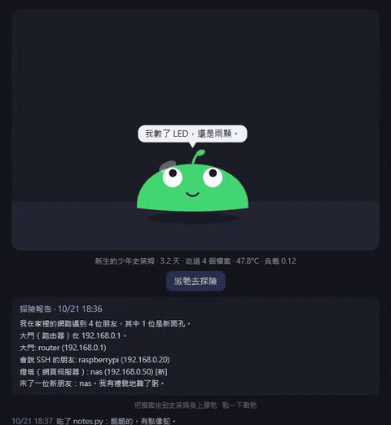

# slime-pi

[](https://github.com/MilkteaTW1/slime-pi/actions/workflows/ci.yml)


[](LICENSE)

**一隻心情由樹莓派真實溫度、負載和網路決定的電子寵物，只有一個 Python 檔，沒有任何相依套件。**

[English](README.md) | **繁體中文**



<!-- 照片位置：桌上的 Pi，旁邊的手機或筆電開著史萊姆網頁。
     存成 docs/photo.jpg 後取消下一行的註解。
 -->

牠不是會笑的系統監控，而是一隻生活跟這台 Pi 綁在一起的小生物：

- **牠能感覺到 Pi。** CPU 太燙會流汗，負載高會喘氣，斷網會眼睛轉圈圈，深夜沒事就睡覺。
- **牠記得你。** 你用 SSH 登入時牠會打招呼，超過 3 天沒來就鬧彆扭。
- **你可以餵牠。** 把任何檔案拖到網頁上，牠就吃掉（檔案**不會**被保存，只記名字、大小和副檔名），個性也會改變：常吃 `.py` 會變「蛇味」，常吃圖片會變「愛作夢」。
- **牠會探險。** 每天第一次登入時，牠會悄悄走一圈你的家用網路，寫一份**探險報告**：遇到誰、誰是新面孔、誰不見了。
- **牠會長大。** 幼年、少年、成年、長老，依序長出芽、天線，最後戴上王冠。
- **牠說你的語言。** 你登入時會讀取 Pi 的系統語言。內建英文和繁體中文，要新增語言[只要一個 JSON 檔](CONTRIBUTING.md#add-a-language)。
- **很省資源。** 每 30 秒醒一次、讀幾個檔案，並被 systemd 限制在單核 10% 和 64 MB 以內。
- **會讓路。** 每次醒來都會檢查記憶體、CPU 負載和溫度。吃緊時會先停掉非必要的事（不去探險）。如果 Pi 連續約 90 秒嚴重不足（可用記憶體低於 5%、負載超過核心數的兩倍，或達 80 °C），牠會先通知你（網頁上的對話框、用 `wall` 廣播到開著的終端機、寫進日記），等 30 秒後自己關掉，把空間留給你的其他程式。牠不會自己重啟，想叫醒牠請輸入 `systemctl --user start slime`，輸入 `slime` 可以看到牠為什麼睡著。

## 需要準備的東西

| 項目 | 說明 |
|---|---|
| 樹莓派 | 已在 Pi 3 Model B 測試。有 systemd 和 Python 3.11 以上的應該都能跑（[歡迎回報你的機型](https://github.com/MilkteaTW1/slime-pi/issues/4)）。 |
| microSD 卡，8 GB 以上 | 裝 Raspberry Pi OS（已測 Bookworm）。Lite 版即可，不需要桌面。 |
| 電源供應器 | 用你那款 Pi 的官方電源。供電不足的 Pi 容易過熱，史萊姆會告訴你。 |
| 網路 | 家裡的 Wi-Fi 或有線網路。探險只會看 Pi 所在的 /24 網段。 |
| 有瀏覽器的手機或電腦 | 用來看史萊姆、餵牠檔案。 |

**接線：不用。** 史萊姆所有資訊都從系統讀（`/sys/class/thermal`、`/proc/meminfo`、負載、`who`、`ip`），不用 GPIO、不用感測器、不用螢幕。想接小螢幕或 LED 點陣的話，[這裡有個開放中的提案](https://github.com/MilkteaTW1/slime-pi/issues/6)。

## 安裝

在樹莓派上執行（Raspberry Pi OS、Python 3.11 以上，不需要 `pip install`）：

```bash
git clone https://github.com/MilkteaTW1/slime-pi.git
cd slime-pi
./install.sh
```

`install.sh` 會建立一個**使用者層級**的 systemd 服務（不需要 root），以及 `~/.local/bin/slime` 指令。它也會嘗試 `loginctl enable-linger`，讓你登出後史萊姆還活著；如果需要 sudo，它會把指令印給你。

接著在同一個網路的瀏覽器開 `http://<你的樹莓派>.local:8077`，或在終端機輸入 `slime`。

要移除：`./uninstall.sh`。牠的記憶會留在 `~/.slime/`，直到你刪掉那個資料夾。

## 怎麼玩

| 你做的事 | 史萊姆的反應 |
|---|---|
| 打開 `http://<你的樹莓派>.local:8077` | 顯示心情、對話框、個性、成長階段、日記和最新的探險報告。頁面每 4 秒更新一次。 |
| 用 SSH 登入 Pi | 跟你打招呼。每天第一次登入還會讓牠出門探險。 |
| 把檔案拖到網頁上 | 牠會吃掉（每個最多 5 MB，太大的牠會拒絕）。每吃一餐加 5 點成長值，也會影響個性。 |
| 點牠 | 牠會被壓扁。每戳 7 下會說一句話。 |
| 按探險按鈕 | 立刻走一圈區網（最多每 10 分鐘一次，Pi 資源吃緊時不會出門）。 |
| 在終端機輸入 `slime` | 印出史萊姆、心情、最近的日記和探險報告。如果牠讓路關掉了，會告訴你時間和原因。 |
| 3 天不理牠 | 牠會鬧彆扭，直到你回來。 |

**長大。** 成長值 = 活了幾小時 + 每餐 5 點 + 每戳一下 0.2 點。20 點變少年，100 點成年，400 點成為長老。

**個性。** 吃滿 3 餐後，吃最多的檔案類型決定個性：`.py` 蛇味、`.js` 毛躁、`.pdf` 書卷、`.jpg`/`.png` 愛作夢、`.mp3` 音樂、`.mp4` 戲劇、`.zip` 敦實、`.exe` 嗆辣、`.xlsx`/`.docx` 整齊。不然就看牠最常處在哪種心情（一直很燙的 Pi 會養出「火爆」的史萊姆）。個性也決定牠的顏色。

## 牠會對你的網路做什麼

探險只會輕輕 ping 一遍**你自己所在的 /24 網段**（例如 192.168.0.1 到 254），以最低優先權執行、同時只有 8 個 ping，而且只在每天第一次登入或你按下按鈕時才跑。對有回應的裝置，牠會檢查 5 個常見連接埠，判斷是路由器、SSH 主機、網頁伺服器還是檔案分享。如果 Pi 拿到的是公開 IP，牠完全不會出門。資料不會離開你的 Pi：結果（IP、MAC 位址、主機名稱）只存在 Pi 上的 `~/.slime/state.json`。

## 檔案與隱私

- 你拖進來的檔案會被讀取後丟棄，只保留檔名、大小和副檔名。
- 網頁沒有帳號也沒有登入，請不要把 8077 連接埠開放到網際網路。
- 牠記得的一切都在 `~/.slime/`，刪掉整個資料夾牠就會重新誕生。

## 心情怎麼決定

| Pi 的狀態 | 史萊姆 |
|---|---|
| 沒有網路 | 暈眩，眼睛轉圈 |
| 65 °C 以上 | 發燙、變紅、流汗 |
| 負載 1.5 以上或記憶體快滿 | 喘氣 |
| 23:00 到 07:00 且很閒 | 睡覺 |
| 3 天以上沒人登入 | 鬧彆扭 |
| 50 °C 以下且很閒 | 開心 |
| 其他 | 發呆 |

表格越上面的優先。

## 疑難排解

- **網頁打不開：** 執行 `systemctl --user status slime`。如果顯示牠讓路關掉了，輸入 `slime` 看原因，再 `systemctl --user start slime`。
- **`<pi>.local` 連不到：** 改用 Pi 的 IP（在 Pi 上執行 `hostname -I`）。
- **語言不對：** 牠會在登入時讀 `/etc/default/locale`。可以在服務環境變數設 `SLIME_LANG=zh_TW.UTF-8` 強制指定。
- **想換連接埠：** 設定 `SLIME_PORT`。

## 開發

在任何電腦上都能跑，測試裡的 Pi 是模擬的。

```bash
python -m unittest discover -s tests     # 單元測試
python tools/check-lang.py               # 檢查語系檔
```

## 參與貢獻

最簡單的方式是翻譯：複製 `locales/en.json`、翻成你的語言、執行 `python tools/check-lang.py`，然後開 PR。新的碎碎念、新的檔案口味、其他機型的測試回報也都很有幫助。詳見 [CONTRIBUTING.md](CONTRIBUTING.md)。

## 需要客製？

想要專屬功能、整合或部署協助？歡迎找我，詳情請見 [墨鋒 Inkacuity](https://inkacuity.com/projects/slime-pi)，或寄信到 [ink@inkacuity.com](mailto:ink@inkacuity.com)。

## 授權

[MIT](LICENSE)
